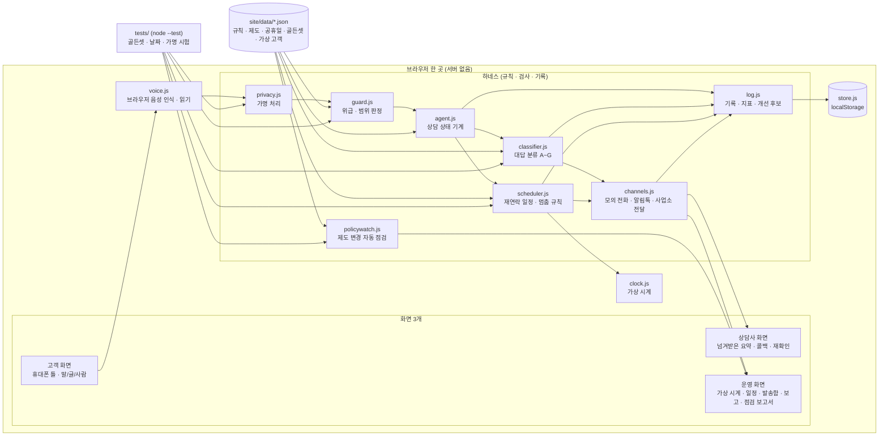

# 아키텍처 — 돌봄 점검 루프 POC

작성 2026-11-19 · 상태: 승인(2026-11-19) · 구현 완료 · 근거: `docs/requirements.md`(수용 기준 AC-01~111)

## 1. 한 장 구성도

## 2. 구성요소 역할

| 구성요소 | 하는 일 | 관련 수용 기준 |
|---|---|---|
| `site/index.html` | 화면 3개(고객 · 상담사 · 운영)를 한 페이지에 탭으로 둔다. 맨 위에 "지금(가상)" 시각을 늘 보여 준다 | AC-01~05, 66 |
| `voice.js` | 브라우저 내장 음성 인식(말 → 글) · 읽기(글 → 말). 크롬이 아니면 글 상담으로 바꾼다 | AC-01, 11 |
| `privacy.js` | 고객 말 · 기록에서 이름 · 연락처 · 주소 · 요양인정번호를 가명으로 바꾼다. 원문은 상담 화면 안에서만 잠깐 쓰고 저장하지 않는다 | AC-84, 89, 90 |
| `guard.js` | **가장 먼저** 위급 신호 5종을 본다(모델 · 설정으로 끌 수 없음). 그다음 질문을 "규정 안 / 관련 있지만 규정 밖 / 무관"으로 나누고, 근거 없는 "규정 안"은 "규정 밖"으로 돌린다. 키워드는 띄어쓰기를 빼고 비교한다 | AC-09~16, 18, 81, 86, 87, 133 |
| `agent.js` | 상담 흐름을 정해진 상태 순서로 진행한다(등급외 상담 · 3개월 안내 · 6개월 점검). 되읽기 확인, 거절 시 다시 묻지 않기, 넘김 선택지, 2번 못 알아들음 처리, 말 바꿈(앞의 답 고치기) 받기, 되풀이 표현에 사과, 넘긴 뒤 말 받기(위급이면 안전 재확인 · 질문은 카드에 덧붙임) · 같은 문장 연속 반복 막기. **운영에서는 이 부분만 LLM으로 바꾼다** | AC-06~08, 15~23, 41, 43~45, 51~56, 100~102, 105, 134~142, 148~150 |
| `classifier.js` | 점검 대답을 A~G 중 하나로 정한다. 정하지 못하면 사람 재확인 대기열로 | AC-22, 46 |
| `scheduler.js` | 90 · 180일 기준일, 고객이 고른 요일 · 시간대, 공휴일 미루기, 밤 9시~아침 8시 금지, 하루 전 알림, 재시도 · 7일 대기 · 2주기 멈춤, 동의 철회 · 반납 시 일정 0건 | AC-29~40, 58, 100~104 |
| `channels.js` | 모의 발송함. 전화 · 알림톡 · 사업소 전달 · 상담사 작업을 "이때 이것이 간다"로 기록한다. 실제로 보내지 않는다 | AC-35~39, 47~50, 53, 106 |
| `tasks.js` | 상담 시간 · 불만 기한은 `rules.json`에서 읽는다(`guard.inCounselHours`와 같은 규칙). 상담사 작업의 처리 기한 · 1시간 전 알림 · 기한 넘김 경보 · 통화 결과 기록(결과 없이 닫기 금지) · 부재 재시도. 순수 함수만 둔다 | AC-122~130 |
| `policywatch.js` | 예시 고시 원문 · 개정안을 넣으면 공포일 · 시행일 추출, 조항별 시행일, 유예 표현 5가지 탐지, 원문 인용 · 숫자 대조, 초록 · 노랑 · 빨강 보고서를 만든다 | AC-79~83, 91~99, 108, 110 |
| `log.js` | 상담마다 4가지(분류 · 넘김 · 대답 시간 · 다시 설명 횟수)를 가명 데이터로 기록. 경보(하루 1번 묶음), 월간 보고, 개선 후보 · 규정 후보 목록 | AC-60~63, 71~73, 109, 111 |
| `clock.js` | 가상 시계. 모든 모듈은 `now()`를 여기서만 받는다 | AC-66, 70 |
| `store.js` | localStorage 읽기 · 쓰기(키 접두사 `ecl:v1:`). 실패해도 화면은 동작 | AC-65 |
| `site/data/*.json` | 규칙 · 제도 정보 · 공휴일 · 골든셋 · 가상 고객의 **정본** | data-model.md |
| `golden.js` | 골든셋 채점. 브라우저 '시험 결과' 탭과 node 시험이 같은 함수를 쓴다 | AC-67~69 · 90 |
| `app.js` | 화면 연결만. 규칙은 하네스 모듈에 둔다 | — |
| `tests/` | 골든셋(50개 이상) + 개인정보 빼내기 문항 + 날짜 계산 · 대화 흐름 · 작업 규칙 시험 + 드리프트 점검(`drift.test.js`: 코드 안 중복 값 · 문서 숫자 · 요구 사본) | AC-67~70, 74, 75, 90, 131, 132 |
| `scripts/demo/` | 자동 시연(Q28). `scenarios.json`(시나리오 · 끼워 넣을 말 정본) → `variants.mjs`(띄어쓰기 · 어미 변형, 시드 난수) → `run.mjs`(agent.js로 대화 200번) → `checks.mjs`(이상 패턴 6가지, 6번째 출처 중복) → `reports/시연_날짜.md`(Git 제외). 사이트에는 들어가지 않는 개발 도구 | AC-143~147, 152 |
| `scripts/sync-copies.mjs` | 요구 문서 사본(포트폴리오 04)을 원본에서 다시 만든다. 사본 위치는 `copies.local.json`(Git 제외) | AC-132 |

## 3. 호출 흐름 (고객이 한마디 할 때)

1. `voice.js`(말) 또는 입력창(글)이 문장을 받는다.
2. `privacy.js`가 개인정보를 가명으로 바꾼다. 이후 모듈은 가명 문장만 본다.
3. `guard.js`가 **위급 신호부터** 본다. 걸리면 선택지 없이 사람 연결로 간다(상담 시간 밖이면 119 · 지자체 안내 + 콜백 예약).
4. `guard.js`가 범위를 판정한다. 무관이면 범위 안내 1문장, 규정 밖이면 선택지 3개(음성은 2개).
5. 규정 안이면 `agent.js`가 현재 상태에 맞는 다음 말을 고른다. 제도 숫자는 `site/data/policy.json`에서만 읽고, 기준 고시 · 날짜를 함께 말한다.
6. 점검 대답이면 `classifier.js`가 A~G로 나누고, `channels.js`가 기존 기능 연결(모의)을 기록한다.
7. 동의 · 종료 사건이면 `scheduler.js`가 일정을 만들거나 지운다.
8. `log.js`가 가명 기록 · 지표를 남긴다. 상담사 화면 · 운영 화면이 이를 읽는다.

## 4. POC가 직접 보여 주는 범위

| 묶음 | POC에서 | 운영에서만(문서로 설명) |
|---|---|---|
| 화면 · 상담 선택 (AC-01~05) | 구현 | — |
| 상담 규칙 · 넘김 (AC-06~23) | 구현(규칙 기반) | — |
| 사람 연결 3분 · 콜백 (AC-24 · 25) | 콜백 예약만 모의 | 실제 상담 인력 연결 시간 |
| 대답 속도 (AC-26~28) | 즉시 대답(규칙 기반) | LLM · 음성 지연 측정 |
| 재연락 일정 · 멈춤 (AC-29~40, 100~104) | 구현 + 가상 시계 | 서버 스케줄러 |
| 점검 · 분류 · 연결 (AC-41~56, 105~106) | 구현(통화 3분 AC-42 제외) | 실제 통화 시간 |
| 데이터 · 보고 (AC-57~63) | 30일 삭제 · 보고 · 후보 구현 | 열람 권한(AC-59) |
| POC · 시험 (AC-64~70) | 구현 | — |
| 개선 루프 (AC-71~78, 107) | 기록 · 경보 · 후보 · 재시험 차단 구현 | 단계 배포 · 자동 되돌림(AC-76 · 77) |
| 제도 변화 · 자동 점검 (AC-79~83, 91~99, 108, 110) | 예시 고시로 구현 | 공식 출처 매일 수집(AS-13) |
| 개인정보 (AC-84~90) | 가명 · 거절 · 시험 구현 | 국외 이전(AC-85) · 저장 암호화(AC-88) |

## 5. 실제 운영으로 바꿀 때 교체하는 곳

| POC 부품 | 운영 부품 | 그대로 두는 것 |
|---|---|---|
| `agent.js` 규칙 상담원 | LLM 상담원(AICC 음성 포함) | `guard.js` · `privacy.js` · `classifier.js` 규칙과 골든셋 |
| `clock.js` 가상 시계 | 서버 시계 + 스케줄러 | `scheduler.js` 날짜 규칙 |
| `channels.js` 모의 발송함 | 전화 API · 알림톡 · 이로움케어 · 파트너 연동 | 발송 내용 · 횟수 규칙 |
| `store.js` localStorage | 서버 DB(암호화) | 데이터 구조(data-model.md) |
| `policywatch.js` 예시 입력 | 국가법령정보센터 API 등 매일 수집 | 점검 규칙(날짜 · 유예 · 해석) |
