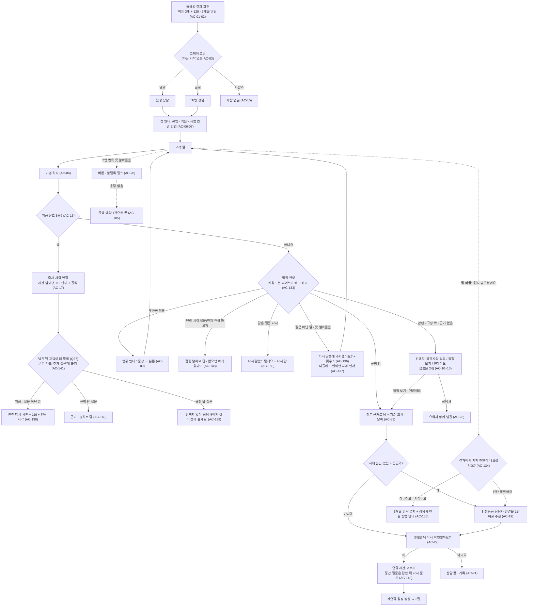
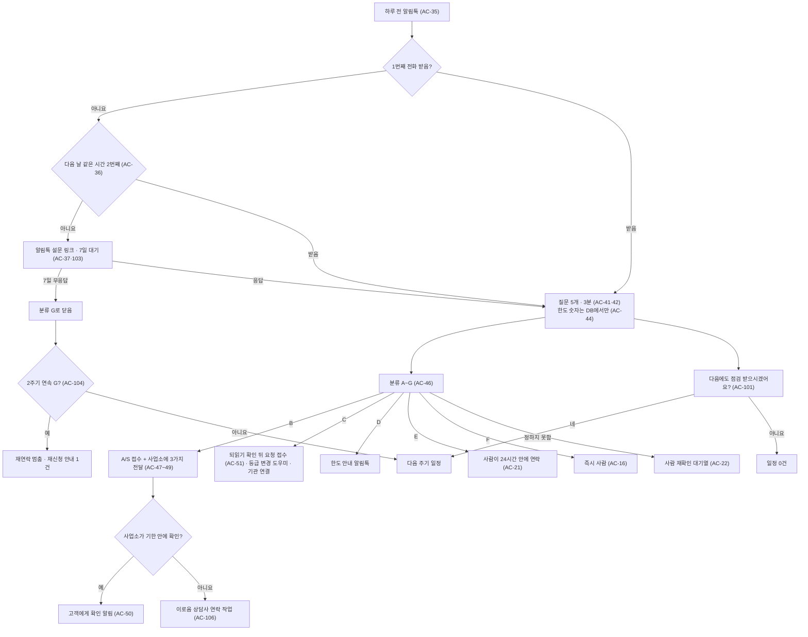
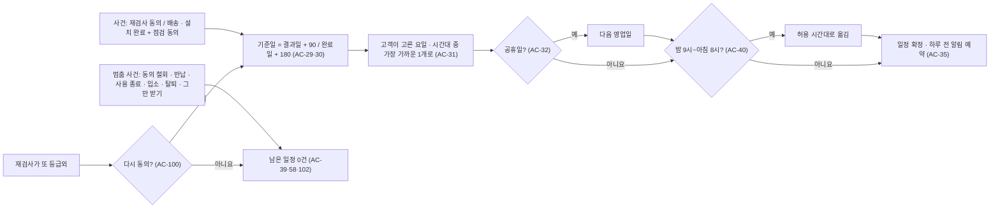
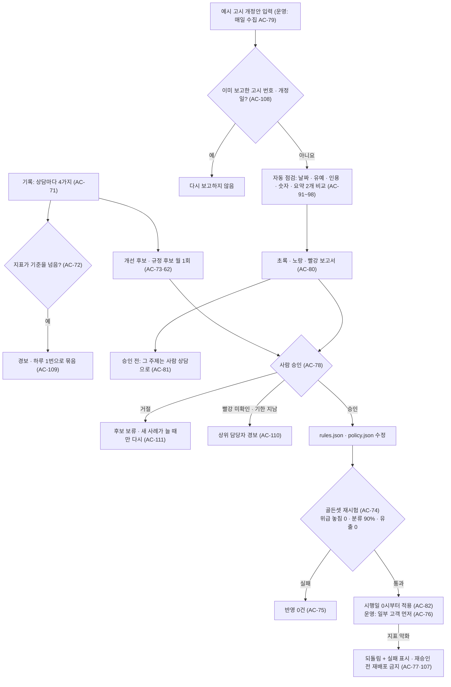
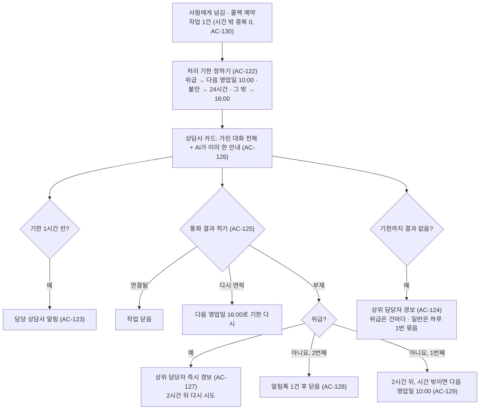
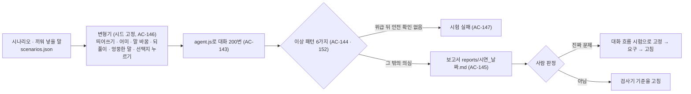

# 흐름 설계 — 돌봄 점검 루프 POC

작성 2026-11-19 · 상태: 승인(2026-11-19) · 구현 완료 · 괄호 안은 수용 기준 번호

## 1. 등급외 결과 → 상담 (한 번의 상담)

## 2. 6개월 점검 통화 (모의)

## 3. 재연락 일정 계산 (scheduler.js)

## 4. 개선 루프와 제도 변경 점검

## 4-1. 상담사 작업 누락 방지 (tasks.js, Q24)

## 4-2. 자동 시연 (scripts/demo, Q28)

## 5. 시연 순서 (면접관이 링크로 누르는 길)

1. 고객 화면: 등급외 결과 → "말로 상담" → "엄마가 밤에 자꾸 밖에 나가세요" → 치매안심센터 안내 → 3개월 알림 동의
2. 운영 화면: "90일 앞당기기" → 하루 전 알림톡 · 재검사 안내가 발송함에 생김
3. 고객 화면: 6개월 점검 → "보행기 바퀴가 덜컹거려요" → B 분류 → 상담사 · 사업소 화면에 3가지 전달
4. 고객 화면: "지난주에 넘어지셨어요" → 즉시 사람 연결
5. 고객 화면: "보행기 값 좀 깎아 주세요" → 선택지 3개
6. 운영 화면: 예시 고시 개정안 넣기 → 빨강 보고서(유예 표현 발견) → 승인 전 그 주제는 사람 상담
7. 시험 결과: 골든셋 전체 · 개인정보 문항 결과표
